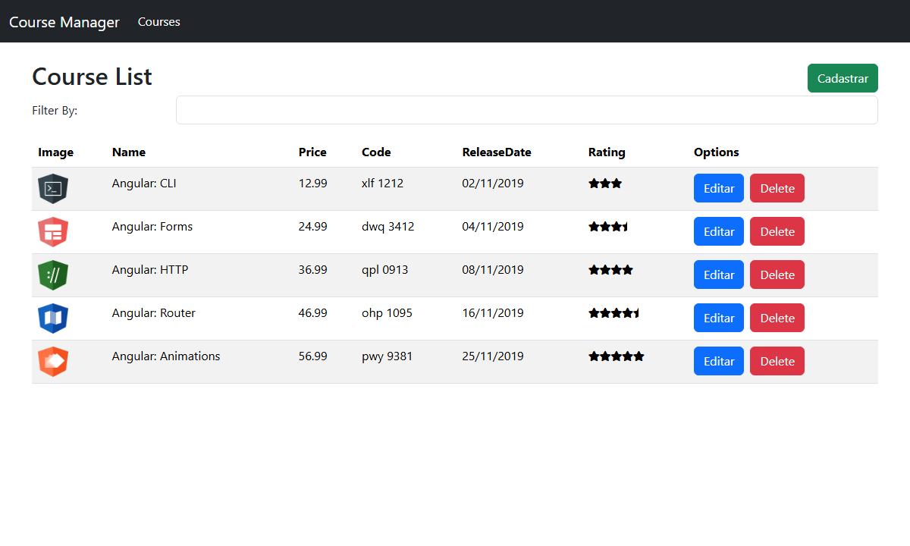
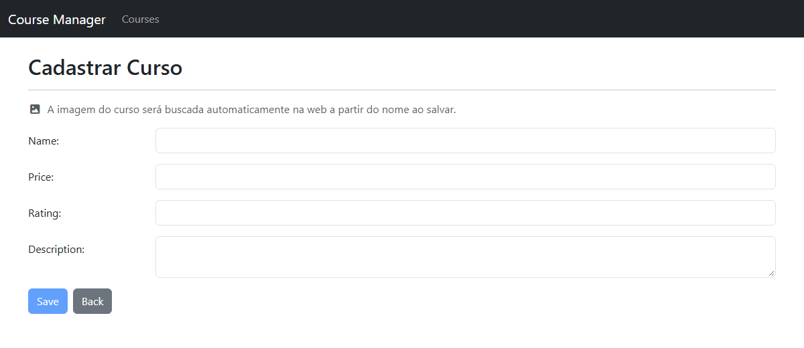
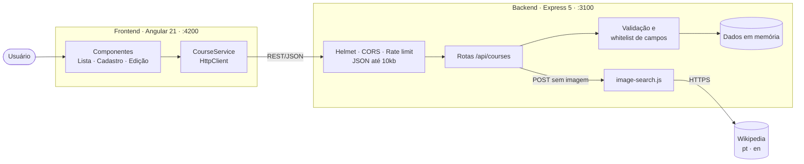

<div align="center">

# 🎓 Course Manager

**Aplicação full stack para gerenciamento de cursos, construída com Angular 21 e uma API REST em Node.js/Express 5.**

[](https://angular.dev)
[](https://www.typescriptlang.org)
[](https://nodejs.org)
[](https://expressjs.com)
[](https://getbootstrap.com)
[](https://vitest.dev)
[](#-segurança)

[Funcionalidades](#-funcionalidades) •
[Tecnologias](#-tecnologias) •
[Como executar](#-como-executar) •
[API](#-api-rest) •
[Segurança](#-segurança) •
[Testes](#-testes) •
[Estrutura](#-estrutura-do-projeto)

</div>

---

## 📸 Telas

| Lista de cursos | Cadastro de curso |
|:---:|:---:|
|  |  |

---

## ✨ Funcionalidades

- **Listagem de cursos** com imagem, preço, código, data de lançamento e avaliação em estrelas (com meia estrela).
- **Filtro em tempo real** pelo nome do curso.
- **Cadastro de cursos** com validação de formulário (template-driven forms).
- **Busca automática de imagem**: ao cadastrar, a API encontra na Wikipedia uma imagem do assunto do curso (ex.: *"Python para Iniciantes"* recebe o logo do Python). Detalhes em [Imagem automática](#-imagem-automática-no-cadastro).
- **Edição e exclusão** de cursos.
- **Página 404** para rotas inexistentes e redirecionamento da raiz para a lista.
- **Layout responsivo** com menu colapsável em telas pequenas.

---

## 🛠 Tecnologias

### Frontend

| Tecnologia | Versão | Uso |
|---|---|---|
| [Angular](https://angular.dev) | 21.2 (LTS) | Framework SPA — NgModules, Router, Forms, HttpClient |
| [TypeScript](https://www.typescriptlang.org) | 5.9 | Linguagem, com `strictTemplates` habilitado |
| [RxJS](https://rxjs.dev) | 7.8 | Programação reativa nas chamadas HTTP |
| [Zone.js](https://github.com/angular/angular/tree/main/packages/zone.js) | 0.16 | Detecção de mudanças |
| [Bootstrap](https://getbootstrap.com) | 5.3 | Layout e componentes visuais |
| [Font Awesome Free](https://fontawesome.com) | 7.3 | Ícones |
| [Angular CLI / `@angular/build`](https://angular.dev/tools/cli) | 21.2 | Build com esbuild + Vite (dev server) |

### Backend

| Tecnologia | Versão | Uso |
|---|---|---|
| [Node.js](https://nodejs.org) | 20.19+ / 22.12+ / 24+ | Runtime |
| [Express](https://expressjs.com) | 5.3 | API REST |
| [Helmet](https://helmetjs.github.io) | 8.3 | Cabeçalhos HTTP de segurança |
| [express-rate-limit](https://github.com/express-rate-limit/express-rate-limit) | 8.7 | Limite de requisições por IP |
| [cors](https://github.com/expressjs/cors) | 2.8 | Controle de origens (CORS) |
| [Wikipedia API](https://www.mediawiki.org/wiki/API:Main_page) | — | Busca de imagens (pública, sem chave) |

### Qualidade

| Tecnologia | Versão | Uso |
|---|---|---|
| [Vitest](https://vitest.dev) | 4.1 | Testes unitários do Angular (runner oficial do `@angular/build`) |
| [jsdom](https://github.com/jsdom/jsdom) | 29.1 | DOM para os testes, sem navegador |
| [`node:test`](https://nodejs.org/api/test.html) | nativo | Testes da API, sem dependências extras |

> **Por que Angular 21 e não 22?** O Angular 21 é a versão **LTS** (suporte até maio de 2027) e roda no Node 22.12+. O Angular 22 exige Node `^22.22.3 || ^24.15`, TypeScript 6 e traria mudanças sem ganho funcional para este projeto. A migração fica recomendada para quando o ambiente estiver no Node 24 LTS.

---

## 🏗 Arquitetura



- O frontend é organizado em **módulos de feature** (`CourseModule`, `CoreModule`, `StarModule`, `AppPipeModule`).
- A URL da API vem de `src/environments/` — em desenvolvimento `http://localhost:3100/api`; em produção `/api` (mesma origem, via proxy reverso).
- Os dados da API ficam **em memória**: reiniciar o servidor restaura os 5 cursos iniciais de [`courses.json`](course-manager-server/courses.json).

---

## 🚀 Como executar

### Pré-requisitos

- **Node.js** `20.19+`, `22.12+` ou `24+` — verifique com `node -v`
- **npm** `10+` — verifique com `npm -v`
- **Git**

### 1. Clonar e instalar

```bash
git clone https://github.com/JotaMarcos/ProjetoCursoAngular.git
cd ProjetoCursoAngular

npm ci                                  # dependências do frontend
cd course-manager-server && npm ci && cd ..   # dependências da API
```

### 2. Subir a aplicação (dois terminais)

```bash
# Terminal 1 — API em http://127.0.0.1:3100/api/courses
npm run server

# Terminal 2 — App em http://localhost:4200
npm start
```

Acesse **http://localhost:4200**. Para encerrar, use `Ctrl + C` em cada terminal.

### Scripts disponíveis

| Comando | Descrição |
|---|---|
| `npm start` | Servidor de desenvolvimento do Angular com recarga automática |
| `npm run server` | Inicia a API REST |
| `npm run build` | Build de produção em `dist/course-manager` |
| `npm test` | Testes do frontend em modo *watch* |
| `npm test -- --watch=false` | Testes do frontend uma única vez (CI) |
| `npm run test:server` | Testes da API |

### Variáveis de ambiente da API

Todas são opcionais.

| Variável | Padrão | Descrição |
|---|---|---|
| `PORT` | `3100` | Porta da API |
| `HOST` | `127.0.0.1` | Interface de rede. Use `0.0.0.0` para expor na rede local |
| `CORS_ORIGINS` | `http://localhost:4200` | Origens autorizadas, separadas por vírgula |
| `RATE_LIMIT_PER_MINUTE` | `300` | Máximo de requisições por IP por minuto |
| `IMAGE_SEARCH` | *(ligado)* | `off` desliga a busca de imagem na web |

Exemplo no PowerShell:

```powershell
$env:PORT = "4000"; $env:CORS_ORIGINS = "http://localhost:4200,http://localhost:4300"; npm run server
```

---

## 📡 API REST

Base URL: `http://127.0.0.1:3100/api`

| Método | Rota | Descrição | Sucesso | Erros |
|---|---|---|---|---|
| `GET` | `/courses` | Lista todos os cursos | `200` | — |
| `GET` | `/courses/:id` | Busca um curso | `200` | `400` id inválido · `404` |
| `POST` | `/courses` | Cria um curso (busca imagem se `imageUrl` for omitida) | `201` | `400` validação · `413` corpo grande |
| `PUT` | `/courses/:id` | Atualiza um curso (o `id` sempre vem da URL) | `200` | `400` · `404` |
| `DELETE` | `/courses/:id` | Remove um curso | `204` | `400` · `404` |

### Modelo de curso

| Campo | Tipo | Obrigatório | Regras |
|---|---|:---:|---|
| `id` | number | — | Gerado pelo servidor |
| `name` | string | ✅ | Até 120 caracteres |
| `description` | string | ✅ | Até 2000 caracteres |
| `price` | number | ✅ | 0 a 100000 |
| `rating` | number | ✅ | 0 a 5 |
| `duration` | number | | 0 a 100000 (minutos) |
| `code` | string | | Até 20 caracteres, letras, números e `-` |
| `releaseDate` | string | | Até 40 caracteres |
| `imageUrl` | string | | `/assets/...` ou `https://...` |

Campos fora dessa lista são descartados.

### Exemplo

```bash
curl -X POST http://127.0.0.1:3100/api/courses \
  -H "Content-Type: application/json" \
  -d '{"name":"Python para Iniciantes","description":"Fundamentos de Python","price":29.9,"rating":5}'
```

```json
{
  "name": "Python para Iniciantes",
  "description": "Fundamentos de Python",
  "price": 29.9,
  "rating": 5,
  "imageUrl": "https://thumb.wikimedia.org/wikipedia/commons/thumb/c/c3/Python-logo-notext.svg/250px-Python-logo-notext.svg.png",
  "id": 6
}
```

Erros de validação retornam a lista de problemas:

```json
{ "errors": ["Campo \"description\" é obrigatório.", "Campo \"price\" deve ser um número entre 0 e 100000."] }
```

---

## 🖼 Imagem automática no cadastro

Quando um curso é criado sem `imageUrl`, a API ([`image-search.js`](course-manager-server/image-search.js)) consulta a Wikipedia em português e em inglês:

1. **Termos tentados em ordem:** nome completo → tecnologia principal (antes do `:`) → primeira palavra.
   *"Angular: Signals"* → `Angular Signals` → `Angular`.
2. **Filtro de relevância:** o título do artigo precisa ser o *assunto* do curso. *"Spring Boot"* é aceito para *"Java Spring Boot"*; *"Monty Python"* e *"Python (gênero)"* (a cobra) são descartados para *"Python"*.
3. **Prioridade para tecnologia:** desambiguações como *"(programming language)"* ou *"(software)"* vencem.
4. **Fallback seguro:** sem resultado relevante, sem internet ou com a API indisponível, o curso é salvo com [`default-course.svg`](src/assets/images/default-course.svg). O cadastro **nunca falha** por causa da imagem.

Também: só imagens **HTTPS da Wikimedia** são aceitas, as consultas são sequenciais e com cache, há timeout de 6 s e o cliente se identifica via `User-Agent`, conforme a [política da Wikimedia](https://www.mediawiki.org/wiki/Wikimedia_APIs/Rate_limits).

> **Limitação conhecida:** nomes genéricos fora de tecnologia (ex.: *"Culinária Italiana"*) podem receber a imagem do artigo geral do tema. Para fotos de qualquer assunto, um provedor como Pexels ou Unsplash (que exigem chave de API) pode ser plugado em `createApp({ findImage })`.

---

## 🔒 Segurança

| Controle | Implementação |
|---|---|
| **CORS restrito** | Apenas as origens de `CORS_ORIGINS` recebem `Access-Control-Allow-Origin` |
| **Validação de entrada** | Whitelist de campos, tipos e limites — bloqueia *mass assignment* e *prototype pollution* |
| **Cabeçalhos HTTP** | Helmet (`X-Content-Type-Options`, `Content-Security-Policy`, etc.); `X-Powered-By` removido |
| **Rate limiting** | 300 req/min por IP (configurável) |
| **Limite de payload** | Corpo JSON até 10 KB (`413` acima disso) |
| **Erros sem vazamento** | Respostas genéricas, sem stack trace |
| **Exposição de rede** | A API escuta só em `127.0.0.1` por padrão |
| **URLs de imagem** | Esquemas como `javascript:` são rejeitados; imagens externas só via HTTPS |
| **Dependências** | `npm audit`: **0 vulnerabilidades** no frontend e na API; `node_modules` fora do Git |

Para reportar uma vulnerabilidade, veja [SECURITY.md](SECURITY.md).

### Em produção

- Sirva o frontend e a API na **mesma origem** (ex.: Nginx com `/api` → `127.0.0.1:3100`) e com **HTTPS**.
- Defina `CORS_ORIGINS` com o domínio real.
- Considere uma **Content Security Policy** no servidor web do frontend.
- Substitua o armazenamento em memória por um banco de dados.

---

## 🧪 Testes

```bash
npm test -- --watch=false   # Frontend: 20 testes (Vitest + jsdom)
npm run test:server         # API: 23 testes (node:test)
```

| Suíte | O que cobre |
|---|---|
| **Frontend** | `AppComponent` montado com o `AppModule` real · `CourseService` (GET/POST/PUT/DELETE com `HttpTestingController`) · lista (renderização, filtro, pipes, botões Cadastrar/Editar, exclusão) · formulário (modo cadastro × edição, navegação após salvar) · navbar (menu mobile) · `StarComponent` · `ReplacePipe` |
| **API** | CRUD completo · ids gerados pelo servidor · rejeição de payload inválido, JSON malformado e corpo grande · prototype pollution · CORS · cabeçalhos de segurança · busca de imagem (relevância, fallback, cache, falha da API) com `fetch` simulado, sem internet |

---

## 📁 Estrutura do projeto

```text
ProjetoCursoAngular/
├── course-manager-server/          # API REST (Express 5)
│   ├── app.js                      # Middlewares, validação e rotas
│   ├── image-search.js             # Busca de imagem na Wikipedia
│   ├── serve.js                    # Ponto de entrada (porta/host)
│   ├── courses.json                # Dados iniciais
│   └── test/                       # Testes da API (node:test)
├── docs/                           # Capturas de tela do README
├── src/
│   ├── app/
│   │   ├── core/                   # Navbar e página 404
│   │   ├── courses/                # Lista, formulário, service e modelo
│   │   ├── pipe/                   # ReplacePipe
│   │   ├── shared/component/star/  # Avaliação em estrelas
│   │   ├── app-routing.module.ts   # Redirecionamento da raiz e rota 404
│   │   └── app.module.ts
│   ├── assets/images/              # Imagens dos cursos e imagem padrão
│   └── environments/               # URL da API por ambiente
├── angular.json
└── package.json
```

---

## 🩺 Solução de problemas

<details>
<summary><b>A lista abre vazia</b></summary>

A API não está rodando. Inicie `npm run server` **antes** de abrir o app e confira http://127.0.0.1:3100/api/courses.
</details>

<details>
<summary><b>Erro <code>EADDRINUSE</code> / porta já em uso</b></summary>

Algum processo antigo ocupa a porta. No PowerShell (troque `4200` por `3100` se for a API):

```powershell
Get-NetTCPConnection -LocalPort 4200 | ForEach-Object { Stop-Process -Id $_.OwningProcess -Force }
```
</details>

<details>
<summary><b>Erro de CORS no console do navegador</b></summary>

O app está em uma origem diferente de `http://localhost:4200`. Adicione-a em `CORS_ORIGINS` e reinicie a API.
</details>

<details>
<summary><b><code>npm install</code> falha com <code>Cannot read properties of null (reading 'edgesOut')</code></b></summary>

Bug do npm 10 ao resolver os *peer deps* opcionais do Vitest quando o `package-lock.json` é gerado do zero. Use `npm ci` (com o lockfile do repositório) ou gere o lockfile com `npx npm@11 install`.
</details>

<details>
<summary><b>Instalar pacotes na API</b></summary>

Rode o comando **dentro** da pasta da API (`cd course-manager-server && npm install <pacote>`). Evite `npm install --prefix course-manager-server <pacote>` a partir da raiz: o npm pode adicionar o próprio frontend como dependência (`"course-manager": "file:.."`).
</details>

<details>
<summary><b>Cursos cadastrados sumiram</b></summary>

Comportamento esperado: os dados ficam em memória e voltam ao estado inicial quando a API é reiniciada.
</details>

---

## 🤝 Contribuindo

1. Crie uma branch a partir da `master`: `git checkout -b feat/minha-melhoria`
2. Faça as alterações e garanta que tudo passa:
   ```bash
   npm test -- --watch=false && npm run test:server && npm run build
   ```
3. Use [Conventional Commits](https://www.conventionalcommits.org/pt-br/) (`feat:`, `fix:`, `chore:`, `docs:`)
4. Abra um Pull Request descrevendo o que mudou e como testar

---

## 👤 Autor

**João Marcos Aires Duarte** — [@JotaMarcos](https://github.com/JotaMarcos)

Projeto desenvolvido como estudo prático de Angular: componentes, módulos, rotas, formulários, pipes, serviços HTTP e integração com uma API REST.
